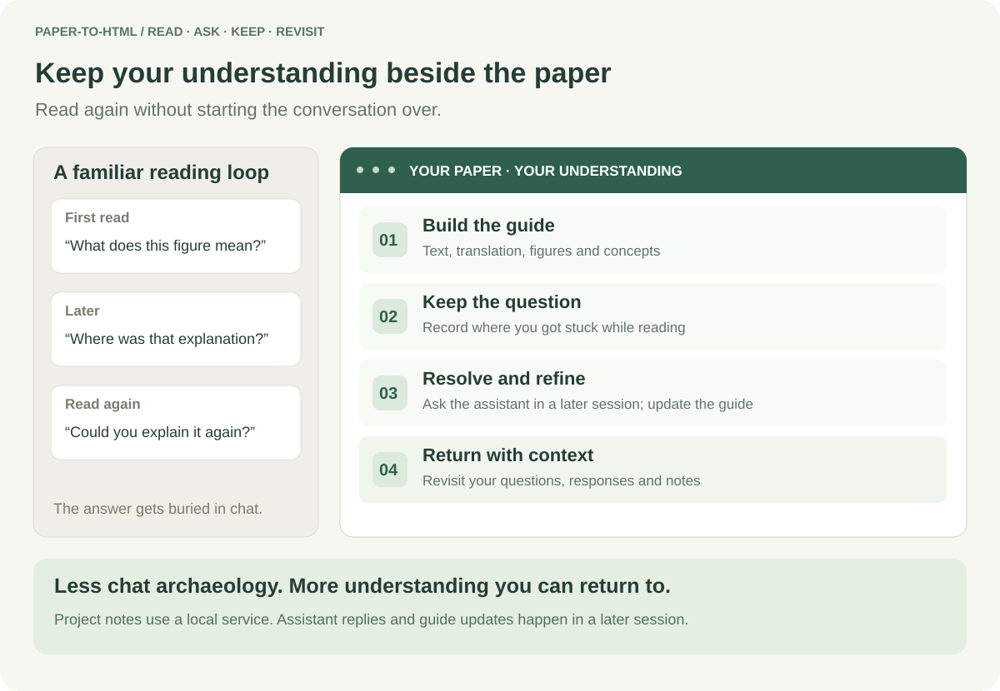
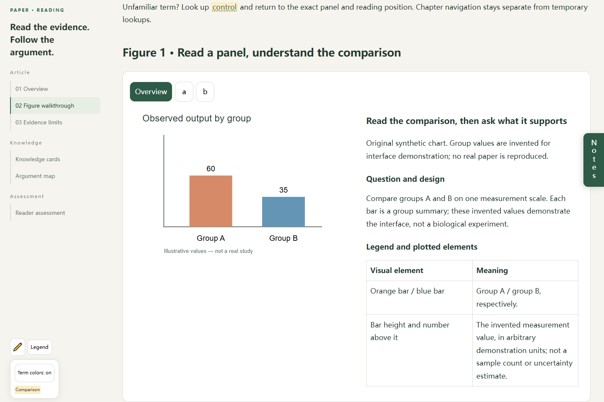

<div align="center">

**[简体中文](README.md) · English**


### A paper guide that keeps what you learned

Keep explanations beside the paper. Return to your questions, not a buried chat thread.

[](https://github.com/BerryIcey/paper-to-html/releases/latest)
[](https://github.com/BerryIcey/paper-to-html/actions/workflows/validate.yml)
[](LICENSE)

**[Live real-paper example](https://berryicey.github.io/paper-to-html/) · [Download v2.4](https://github.com/BerryIcey/paper-to-html/releases/latest/download/paper-to-html-v2.4.zip) · [Read the Skill](https://github.com/BerryIcey/paper-to-html/blob/main/skills/paper-to-html-v2.4/SKILL.md) · [Release notes](docs/latest-changes.en.md) · [Quick start](#start-in-three-steps) · [Report an issue](https://github.com/BerryIcey/paper-to-html/issues)**

</div>

**A Codex Skill for source-grounded, Chinese-first paper co-reading. Only Codex has been tested; other agents have not been tested.** It combines continuous text and translation, figure walkthroughs, concept cards and an argument chain. Current focus: biomedical experimental papers. Creating a guide needs an assistant with PDF access; the finished static reader works offline. Project notes need a local service.

## Understand it once. Keep it for the next reading.

A good AI explanation helps in the moment. Weeks later, you may forget the reasoning, lose the right message in a long thread, and ask the same question again.

**paper-to-html brings those explanations back to the paper.** Start with a readable guide, note what still confuses you, ask the assistant to address it in a later session, and retain the responses and any requested guide updates. Your paper project gradually holds your own questions, clarifications and reading notes—so reopening it also brings back where you got stuck and what helped.



The goal is fewer repeated explanations and less searching through chat history. It still supports ongoing questions: project notes save through the local service, and the assistant handles them in a later session; the webpage does not answer or update itself instantly.

## See the reader



*Actual interface screenshot, original synthetic text and invented charts; not a real-paper result or a complete v2.4 acceptance example.* [Download demo HTML](https://raw.githubusercontent.com/BerryIcey/paper-to-html/main/demo/en/paper-reading.html), save and open it in a browser. [Open the real-paper preview](https://berryicey.github.io/paper-to-html/) instead of downloading. The screenshot above is the synthetic interface demo.

## A real paper you can read now

**[Open Mulet-Lazaro et al. 2024 →](https://berryicey.github.io/paper-to-html/)**

This is an existing Chinese reading guide, reused as a public static preview: original text, translation, figure explanations, 47 concept cards and an argument chain. It is not a newly generated v2.4 benchmark. The source article is CC BY 4.0; [attribution and adaptations](THIRD_PARTY_NOTICES.md) are documented. No private note queue or attachments are published. Visitor drafts stay in the current browser; static hosting cannot save notes to the author's project.

One previous run, **reported by the maintainer**, took about **50 minutes** and used about **15% of a Plus account's weekly allowance**. This is a single anecdotal record, not a typical cost, token count or guaranteed runtime; it is not identified as this hosted example's cost. [Record and limits](docs/usage-observation.md).

## Start in three steps

### 1 · Install the recommended release

Download [paper-to-html-v2.4.zip](https://github.com/BerryIcey/paper-to-html/releases/latest/download/paper-to-html-v2.4.zip). Place its complete `paper-to-html-v2.4` folder in your configured Codex Skill directory, commonly `~/.codex/skills/`. Back up an existing installation outside that directory first, then start a new chat to confirm discovery.

The release is **v2.4**; the invocation is **`$paper-to-html-v2.4`**. Repository updates do not automatically update installed copies.

### 2 · Provide a paper

```text
$paper-to-html-v2.4
Create a Chinese HTML walkthrough of this paper.
Translate the core text. Choose detailed, brief or shared figure walkthroughs
as the argument requires. Explain key concepts and the full argument.
```

Use a PDF you are entitled to provide. The default includes the core text, main figures, necessary knowledge cards and a closing assessment. Methods, algorithms or proofs that carry the main contribution are also core. Reproduction details, supplementary walkthroughs and quizzes can be requested separately. Missing source materials should be disclosed.

### 3 · Read and continue

The static HTML supports offline panel switching, zoom, cards and highlighting. Open the paper's local service to save project notes for a later assistant session. Notes **do not trigger an instant GPT response**. Browser drafts and project notes are separate stores.

<details>
<summary>Try the components without a model</summary>

Requires Python, but no OpenAI API key:

```sh
git clone https://github.com/BerryIcey/paper-to-html.git
cd paper-to-html
python skills/paper-to-html-v2.4/assets/reader-components/reading_server.py --root demo/en --port 18765
```

Open `http://127.0.0.1:18765/paper-reading.html` on the same machine. This is a temporary demo service; paper projects need a suitable independent background service.

</details>

## Three core reading experiences

| Need | Reader approach |
|---|---|
| Read a figure | Purpose → comparison → plotted elements → observation → inference |
| Understand a concept | Self-contained cards, article-specific use, lookup and return |
| Follow the paper | Questions → evidence gaps → next steps, including negative results |

<details>
<summary>See detailed feature explanations and illustrations</summary>


The consistent-ratio feature illustrations explain the reading approach and interactions. They are not exact UI screenshots; simulated values are not findings from a real paper. The English demo is separate; the released Skill remains Chinese-first.

### 01 · Figure walkthroughs: read the evidence step by step

Each main figure has an original lookup; panels receive detailed, brief or shared explanations as the argument requires. Switching panels changes the image and its explanation together; zoom helps inspect labels and details.

A walkthrough starts with **why this comparison is needed, who or what is compared, and how the input becomes a plotted element**. It then maps axes, colors, symbols and units to their meanings, reads a specific visible observation, and explains how that observation supports a conclusion. The final step identifies what was answered and what remains open.

This goes beyond a caption or “significant difference.” Captions, translations, short findings and detailed explanations have different roles. The reader should be able to reconstruct the comparison and inference.


### 02 · Knowledge cards: clarify a concept and keep your place

The default reader has completed relevant undergraduate coursework. Select concepts beyond that baseline when they affect understanding; databases help verify meanings and sources.

Lookup links in the text and captions open cards for unfamiliar concepts that matter to understanding. A useful card explains **what the concept is, how it works or relates to others, why the paper uses it, and where interpretation needs care**. Expanding an abbreviation alone is insufficient.

Concepts are discovered in the current paper rather than limited to an existing vocabulary list. Ambiguous names need context; related concepts need an explicit connection. After a temporary lookup, return to the previous panel and reading position.


### 03 · The argument map: understand why each step follows

Knowing each figure is not enough to understand the whole paper. The argument map connects **what is known → what is missing → why this approach helps → how the result changes the interpretation**. A flow diagram locates the steps; detailed explanations justify their connections.

It is not a list of figure titles or a chain of unexplained terms. Parallel evidence, negative findings, supporting checks and open branches should remain visible. Research order alone does not establish chronology or causation.


[Download the English demo HTML](https://raw.githubusercontent.com/BerryIcey/paper-to-html/main/demo/en/paper-reading.html), save it, and open it in a browser. GitHub's HTML file page displays source code. This repository provides a **Codex Skill and reader components**; generated explanations still need source review.

</details>

## Current release

**v2.4: Darwin-assisted acceptance workflow; no new features or additional manual optimization.** Independent paired review and user confirmation were included. This supports modest workflow clarity, not demonstrated gains in whole-paper accuracy or comprehension.

[v2.4 notes](docs/latest-changes.en.md) · [Version history](docs/versions.en.md) · [Setup FAQ](docs/getting-started.en.md). v2.3 and older packages remain available. This presentation update does not alter the v2.4 archive.

## Practical limits

- **Environment:** A Skill-capable assistant with PDF access; Python for components and services, PyMuPDF for figure crops, and Node.js for JavaScript checks. Optional browser regression tests require Playwright and an installed browser.
- **Citation display:** Remove bibliographic number markers from source text, translations, captions and explanations; preserve figure references, quantities, units and scientific superscripts. Keep provenance in the source ledger and original paper.
- **Review:** Translations, labels, numbers and inferences need source checks. Passing tests does not establish scientific accuracy, comprehension or coverage of every discipline. Only Codex is tested as an agent; other agents are untested.
- **Persistence:** Project notes need the local service. Automatic offline retry, cross-device sync and instant model responses are not implemented.
- **Access:** `127.0.0.1` is local to each device. Offline reading on a phone does not connect it to a computer's loopback server.
- **Versions and background services:** Projects can keep zero, one or two historical copies in addition to the latest. Background startup differs by operating system; actual restart survival requires separate verification.

## Additional reading tools

Understanding the paper comes first. These tools support lookup, annotation and follow-up:

| Tool | What it does |
|---|---|
| Legend and term colors | Explain webpage term categories and toggle their backgrounds; original figure colors are interpreted separately |
| Highlighter | Explicitly enable highlighting and undo marks; term colors and personal highlights have independent controls |
| Notes | Save text or screenshots in the local paper project for a later assistant session |


Project notes require the local service. Browser drafts are a separate store, and saving a note does not trigger an instant GPT response. Zoom, panel switching and lookup return also support reading.

## Feedback and contributions

[Report an issue](https://github.com/BerryIcey/paper-to-html/issues) with the version, browser, expected and observed behavior. For explanation problems, identify the object, comparison or inference that remains unclear.

Current priorities: missed specialist concepts, excessive basic explanations, consistent quality across long papers, touch interaction and different forms of argument. Do not upload private notes, credentials or paper full texts without permission.

Code and general documentation use the [MIT license](LICENSE). Papers and third-party images retain their applicable rights; the public case is shared under its separate license; see [third-party notices](THIRD_PARTY_NOTICES.md). Private notes are not published.

If useful, **Star** the repository to find it again. Specific feedback on an unclear object, comparison or inference helps improve it.

[Contribution guide](CONTRIBUTING.md) · [Suggest an improvement](https://github.com/BerryIcey/paper-to-html/issues/new?template=feature_request.md)
