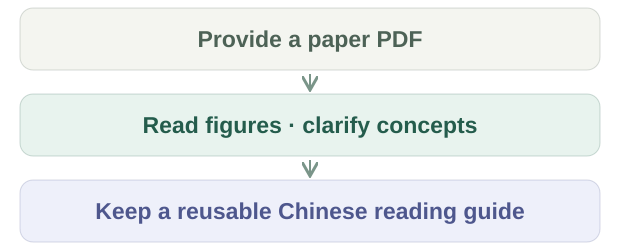
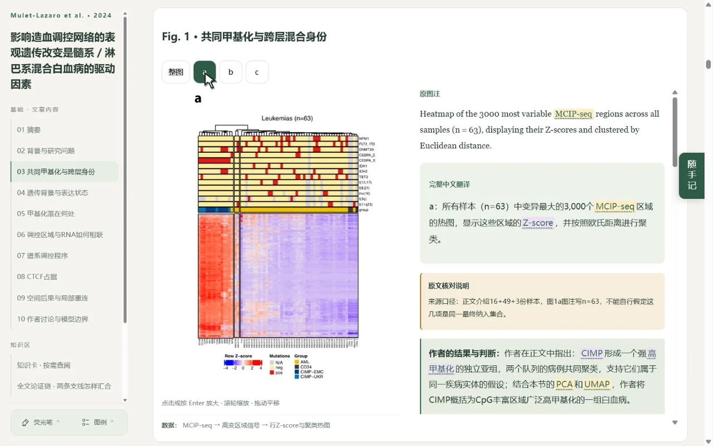
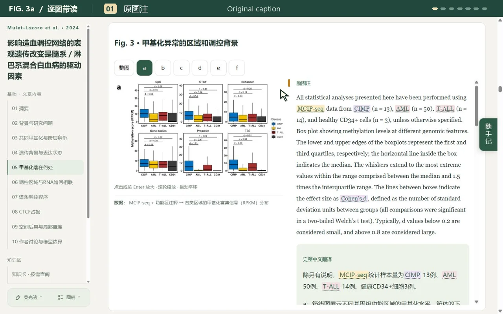
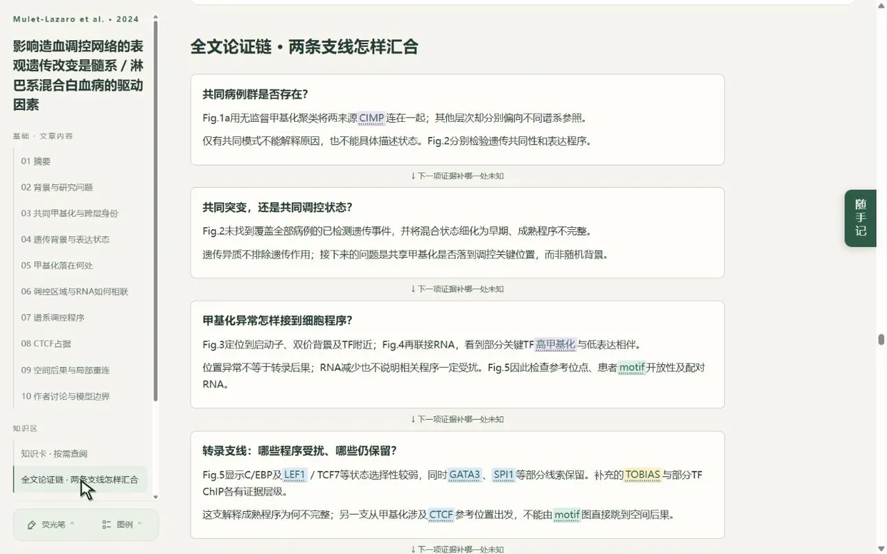

<div align="center">

**[简体中文](README.md) · English**

# paper-to-html

For readers who revisit papers in depth, paper-to-html keeps AI figure walkthroughs, concept explanations and a guide to the paper’s argument alongside the original text.



[](https://berryicey.github.io/paper-to-html/)

**[Download v2.5](https://github.com/BerryIcey/paper-to-html/releases/download/v2.5/paper-to-html-v2.5.zip) · [Start](#start-in-three-steps) · [Release notes](docs/latest-changes.en.md)**

</div>

[](https://berryicey.github.io/paper-to-html/)

Example: a Chinese guide to Mulet-Lazaro et al. (2024). [Attribution and license](THIRD_PARTY_NOTICES.md).

This example predates v2.5 and was not regenerated with it. The current downloadable Skill is **v2.5**.

A Chinese-first Codex Skill, currently focused on biomedical experimental papers. Creating a guide needs an assistant with PDF access; the static reader works offline.

**Explore:** [Figures](#figure-walkthroughs) · [Concepts](#concept-cards) · [Argument](#the-full-argument) · [Reading tools](#reading-tools) · [Get started](#start-in-three-steps)

## Figure walkthroughs


> **What did the authors do? What did they conclude? Which plotted evidence supports it?**

The action summary, author findings and detailed walkthrough answer different questions. Each switchable panel has its own explanation; complex workflows follow their actual branches.

- **Identify the comparison:** who or what is compared, and how data become a point, cell or bar.
- **Read the encoding:** labels, axes, colors, shapes, units and method outputs explained beside the figure.
- **Check the statistics:** what a star tests, its reference, P values or thresholds and corrections; missing definitions stay explicit.
- **Follow the inference:** a real plotted example connects observations to author findings, including exceptions and limits.

### Figure 3a example: from box plots to a conclusion

The figure compares methylation signals across six types of genomic regions. The original stays visible on the left. The walkthrough on the right introduces the caption, translation and groups, explains the axes, colors and Cohen’s d, and shows what the observations support.

[](https://berryicey.github.io/paper-to-html/#results-figure-3)

Open a panel to zoom in when you need to check the labels.


## Concept cards


**Open a term → understand it → return to the same panel and reading position.** Lookup links appear in the text, translations and captions.

| Understanding | What the card explains |
|---|---|
| Identity | What is it, and what could be confused with it? |
| Mechanism | How does it work, and how is the readout produced? |
| Article-specific role | Why do the authors use it here? |

Concepts follow the paper and reader baseline, rather than a fixed vocabulary quota. Distinct concepts receive self-contained explanations before relationships are introduced.


## The full argument


```text
Question → evidence → remaining gap → why the next approach helps
                ↘ parallel checks, negative results and open branches
```

Connect figures to the paper's questions rather than listing their titles. Explain what each result answers, what is still missing, and why the next method is informative. Research order alone does not establish causation.



## Reading tools

| 🔎 Lookup and navigation | 🖍️ Marks and colors | 📝 Notes (optional) |
|---|---|---|
| Figure navigation, panel switching, zoom/pan and exact lookup return | Enable highlighting, undo marks; term colors are independent | Save text or screenshots in this paper’s local folder for a later assistant session |
| Static browser reading | Offline reading and local marks | Writing notes to that folder needs the local service; no instant model response |

> [!NOTE]
> Browser drafts are separate from notes saved in the paper’s local folder. Automatic offline retry and cross-device sync are not implemented.

## Start in three steps

### 1 · Install v2.5

[**Download paper-to-html-v2.5.zip**](https://github.com/BerryIcey/paper-to-html/releases/download/v2.5/paper-to-html-v2.5.zip) · [SHA-256](https://github.com/BerryIcey/paper-to-html/releases/download/v2.5/paper-to-html-v2.5.sha256)

Place the complete `paper-to-html-v2.5` folder in your configured Codex Skill directory, commonly `~/.codex/skills/`. Back up an existing installation outside discovery directories, then start a new chat to confirm discovery. Repository updates do not update installed copies automatically.

### 2 · Provide the paper

```text
$paper-to-html-v2.5
Create a Chinese HTML walkthrough of this paper.
Translate core text and choose detailed, brief or shared explanations as needed.
Explain key concepts, preserve figures and author findings, and connect the argument.
```

Use a PDF you are entitled to provide. The default preserves author discussion and limitations, without a separate reader critique. Methods, algorithms or proofs carrying the main contribution remain core. Supplementary walkthroughs and reproduction details are optional.

### 3 · Open and read

Open the generated HTML in a browser for panel switching, zoom, cards and marks. Use the paper's local service when you want to save notes in this paper’s local folder. [Setup and FAQ](docs/getting-started.en.md).

## Release and scope

**Current release: v2.5.** [Full changes (Chinese)](docs/v2.5-changes.md) · [Skill source](skills/paper-to-html-v2.5/SKILL.md) · [Version history](docs/versions.en.md).

- Current focus: biomedical experimental papers. Only Codex is tested; other agents remain untested.
- Source review is required; structural and interaction tests do not prove scientific accuracy or reader comprehension.
- Assembly and local services use Python; PDF crops need PyMuPDF. Optional browser regressions require Node.js, Playwright and a browser.
- Publication overwrites the stable latest file. Backup-count settings and history rotation are removed; existing notes, attachments and historical files are preserved.

<details>
<summary>Measured creation runs: time and tokens</summary>

| Date | Paper / Skill | Model / reasoning effort | Creation time | Total tokens | Cached input subset |
|---|---|---|---|---:|---:|
| 2026-10-29 | eCHROMA / v2.4 | gpt-6.1-sol / low | About 19 min 29 sec | 5,858,896 | 5,668,096 |
| 2026-11-08 | NFE2 redox / v2.5 | gpt-6.1-sol / high | About 41 min 44 sec | 11,703,503 | 11,373,952 |

These are two measured creation runs, including repeated context across calls, rather than a fixed per-paper cost or an API bill. [Full records and counting scope](docs/usage-observation.md).

</details>

## Feedback and contributions

[Report an issue](https://github.com/BerryIcey/paper-to-html/issues) with your version, browser and expected/observed behavior. For unclear teaching, identify the object, comparison or inference. Do not upload private notes, credentials or paper full texts without permission.

Code and general documentation use the[MIT license](LICENSE). Papers and third-party images retain their own rights. [Contributing](CONTRIBUTING.md) · [Third-party notices](THIRD_PARTY_NOTICES.md).
