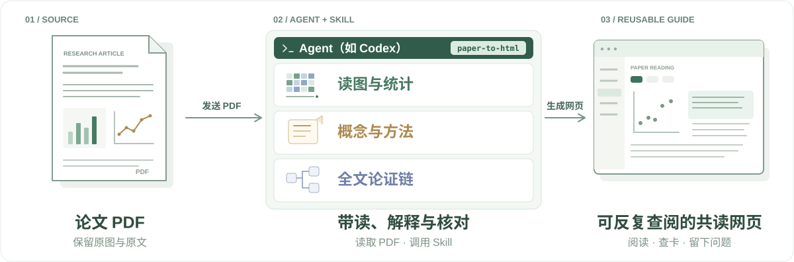
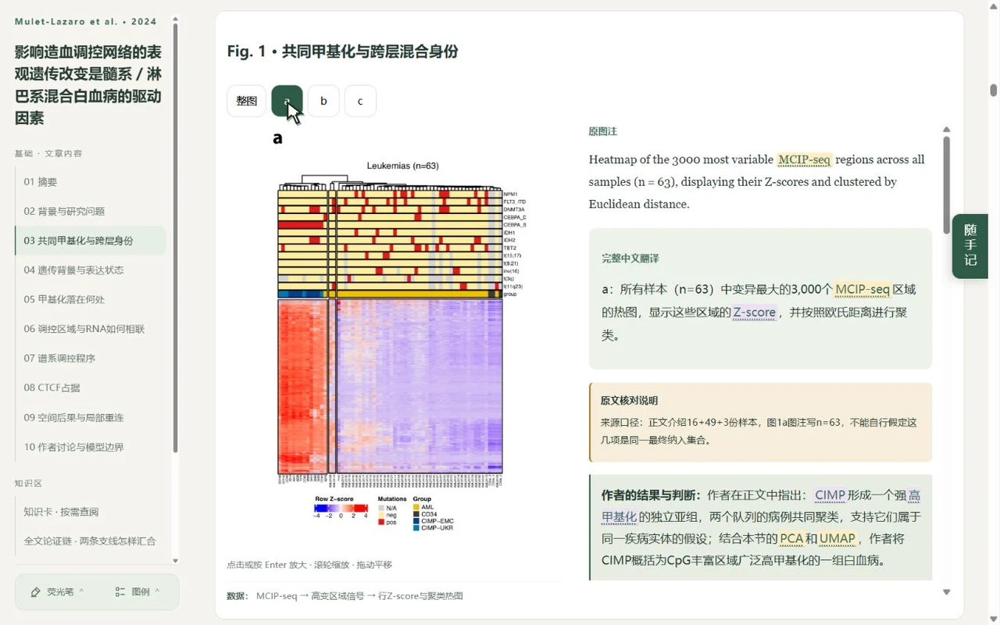
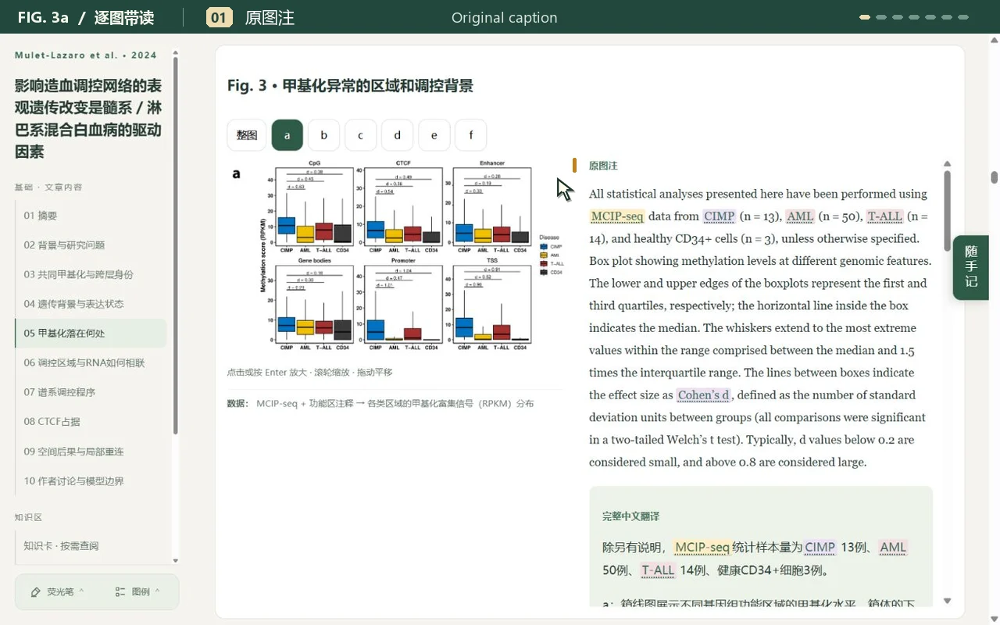
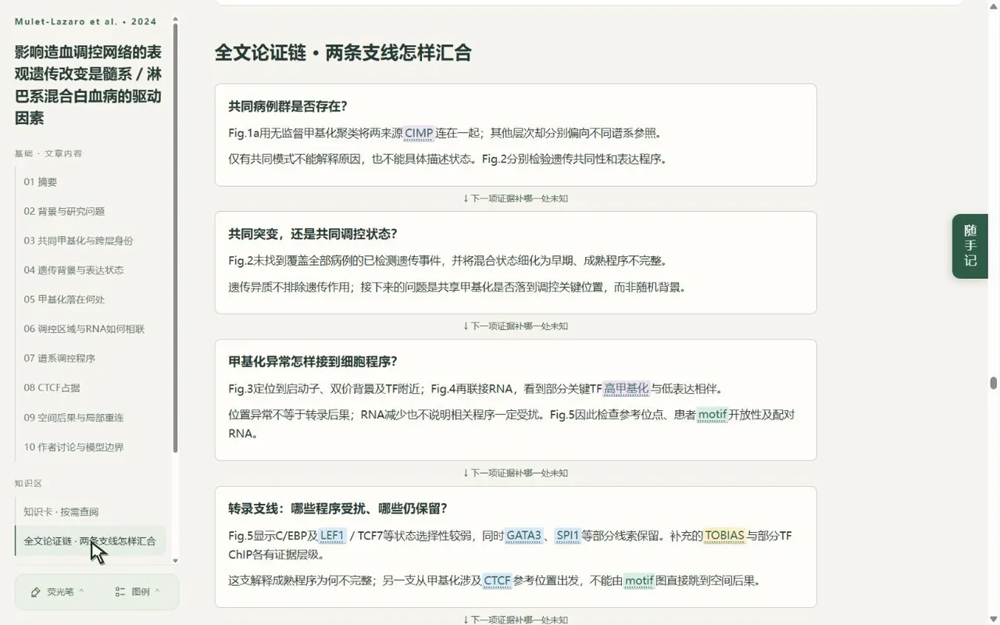

<div align="center">

**简体中文 · [English](README.en.md)**

# paper-to-html

为需要反复精读论文的读者，把 AI 的逐图讲解、概念解释和全文梳理留在论文旁。



[](https://berryicey.github.io/paper-to-html/)

**[下载 v2.5.1](https://github.com/BerryIcey/paper-to-html/releases/download/v2.5.1/paper-to-html-v2.5.1.zip)　·　[开始使用](#三步开始)　·　[更新说明](docs/latest-changes.md)**

</div>

## 一行命令安装

需 Node.js 22.20+ 和 Git，在终端执行：

```bash
npx -y skills add BerryIcey/paper-to-html --skill paper-to-html-v2.5.1 -a codex -g -y
```

安装后新开 Codex 聊天，使用 `$paper-to-html-v2.5.1` 调用；已有同名安装请先备份。

[](https://berryicey.github.io/paper-to-html/)

案例：Mulet-Lazaro 等（2024）的中文共读网页。[来源与许可](THIRD_PARTY_NOTICES.md)。

供 Codex 使用的中文论文共读 Skill，当前重点是生物医学实验论文。制作需要能读取 PDF 的助手；默认交付一个面向桌面的本地服务版。

**功能导航：** [逐图带读](#逐图带读) · [知识卡](#知识卡) · [全文论证链](#全文论证链) · [阅读工具](#阅读工具) · [三步开始](#三步开始)

## 逐图带读


> **这张图在做什么？作者得到了什么答案？图上哪些证据支持它？**

这三个问题分别对应简短概括、作者的结果与判断、详细带读，互相补充。每个可切换小图都有自己的解释，复杂流程沿箭头走读。

- **先认对象**：比较谁和谁，数据怎样变成一个点、格或柱。
- **读懂编码**：英文分类、坐标、颜色、点形、单位与方法输出，在图旁解释。
- **核对统计**：星号检验什么、参照是谁、P值或阈值及校正如何定义；来源没写清时标出缺口。
- **走到判断**：用图上一个真实例子连接观察与作者结论，保留反例和限定。

### 图 3a 实例：从箱线图读到结论

这张图比较六类基因组区域的甲基化信号。左侧保留原图，右侧先交代图注、译文和比较对象，再解释坐标、颜色与 Cohen’s d，最后对照图中的观察说明结论能推到哪一步。

[](https://berryicey.github.io/paper-to-html/#results-figure-3)

想核对原图中的标注时，可以点开小图放大。


## 知识卡


**点开术语 → 建立理解 → 返回同一小图和文字位置。** 正文、译文和图注中的关键术语都有查阅入口。

| 先建立什么认识 | 卡片要回答什么 |
|---|---|
| 身份 | 它是什么，容易与什么混淆？ |
| 原理 | 怎样工作，为什么能得到这个读数？ |
| 本文用途 | 作者为什么用它，与当前结果有什么关系？ |

按当前论文和读者基础选择概念，不为凑词数堆基础词条；不同关键概念独立讲清，相关概念再建立联系。


## 全文论证链


```text
研究问题 → 当前证据 → 仍有缺口 → 下一步为什么能回答
               ↘ 并行验证、否定结果与尚未解决的分支
```

把图放回全文问题，而不是只把图标题排成目录。说明前一结果回答了什么、为什么仍不够、下一方法如何补充；研究顺序与因果关系分别判断。



## 阅读工具

| 🔎 查阅与定位 | 🖍️ 标记与配色 | 📝 随手记（可选） |
|---|---|---|
| 图号导航、整图/小图切换、图片缩放和平移、知识卡返回原处 | 主动开启荧光笔、撤销标记；术语颜色与个人标黄独立 | 在阅读位置记录文字或截图，保存到这篇论文的本地文件夹，下一轮由助手处理 |
| 桌面浏览器通过本地服务阅读 | 支持本机标记 | 把笔记写入该文件夹需要本地服务；不即时调用模型 |

## 三步开始

### 1 · 安装 v2.5.1

[**下载 paper-to-html-v2.5.1.zip**](https://github.com/BerryIcey/paper-to-html/releases/download/v2.5.1/paper-to-html-v2.5.1.zip) · [SHA-256校验](https://github.com/BerryIcey/paper-to-html/releases/download/v2.5.1/paper-to-html-v2.5.1.sha256)

解压后将完整 `paper-to-html-v2.5.1` 文件夹放进当前设备的 Codex Skill 目录，通常是 `~/.codex/skills/`。已有安装先在技能目录外备份，新开聊天确认技能可用。GitHub 更新不会自动替换本机安装。

### 2 · 提供论文并调用

```text
$paper-to-html-v2.5.1
把这篇论文做成中文共读网页。
完整翻译核心正文，按论证需要决定详讲、简讲和跨图比较。
关键概念独立讲清，保留原图、作者结论和全文论证链。
```

提供有权使用的PDF。基础版保留作者讨论与局限，不默认生成独立读者评议；贡献主体中的方法、算法或证明也属于核心。附图详解、复现细节和复习内容按需追加。

### 3 · 打开网页阅读

启动对应论文的本地服务，在桌面浏览器打开交付的阅读地址，即可切图、放大、查卡、标记并保存随手记。桌面快捷方式可指向同一阅读入口。[安装与常见问题](docs/getting-started.md)

## 版本与使用范围

**当前版本 v2.5.1**：[完整变更](docs/v2.5.1-changes.md) · [Skill 源文件](skills/paper-to-html-v2.5.1/SKILL.md) · [历史版本](docs/versions.md)

- 当前重点为生物医学实验论文；仅在 Codex 测试，其他 Agent 尚未测试。
- 默认只制作和维护一个桌面本地服务版，不另交付桌面离线 HTML 副本；手机／平板专项适配和验收按需另做。
- 图文解释需要逐源核对；结构或交互测试通过不证明所有科学解释正确，也不证明读者已经理解。
- 组件装配和本地服务使用 Python，PDF 裁图需要 PyMuPDF；可选浏览器回归另需 Node.js、Playwright及浏览器。
- 默认覆盖固定同名最新版，不再提供备份数量选择或历史轮转；既有笔记、附件和历史资料不自动删除。

<details>
<summary>查看实际制作的耗时与 token 记录</summary>

| 日期 | 论文 / Skill | 模型 / 推理强度 | 制作耗时 | 累计 tokens | 其中缓存输入 |
|---|---|---|---|---:|---:|
| 2026-10-29 | eCHROMA / v2.4 | gpt-6.1-sol / low | 约19分29秒 | 5,858,896 | 5,668,096 |
| 2026-11-08 | NFE2 redox / v2.5 | gpt-6.1-sol / high | 约41分44秒 | 11,703,503 | 11,373,952 |

以上为两次实际制作观察，包含多次调用中的重复上下文，不是每篇固定消耗或API账单。[完整记录与统计口径](docs/usage-observation.md)。

</details>

## 反馈与参与

[反馈问题](https://github.com/BerryIcey/paper-to-html/issues)时，请注明版本、浏览器、期待与实际行为；讲解不清时指出具体对象、比较或推理步骤。请勿上传私人笔记、凭据或未经许可的论文全文。

代码与通用说明使用[MIT许可](LICENSE)，论文及第三方图片保留其原有权利条件。[贡献指南](CONTRIBUTING.md) · [第三方署名](THIRD_PARTY_NOTICES.md)
