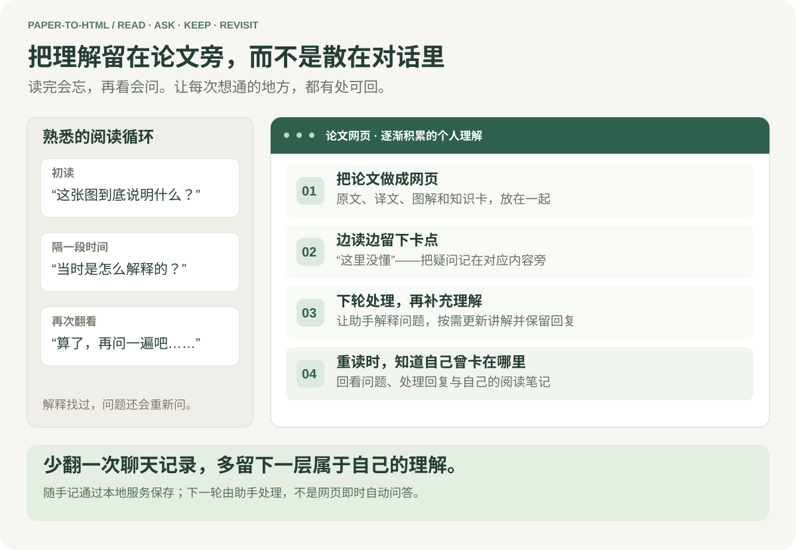
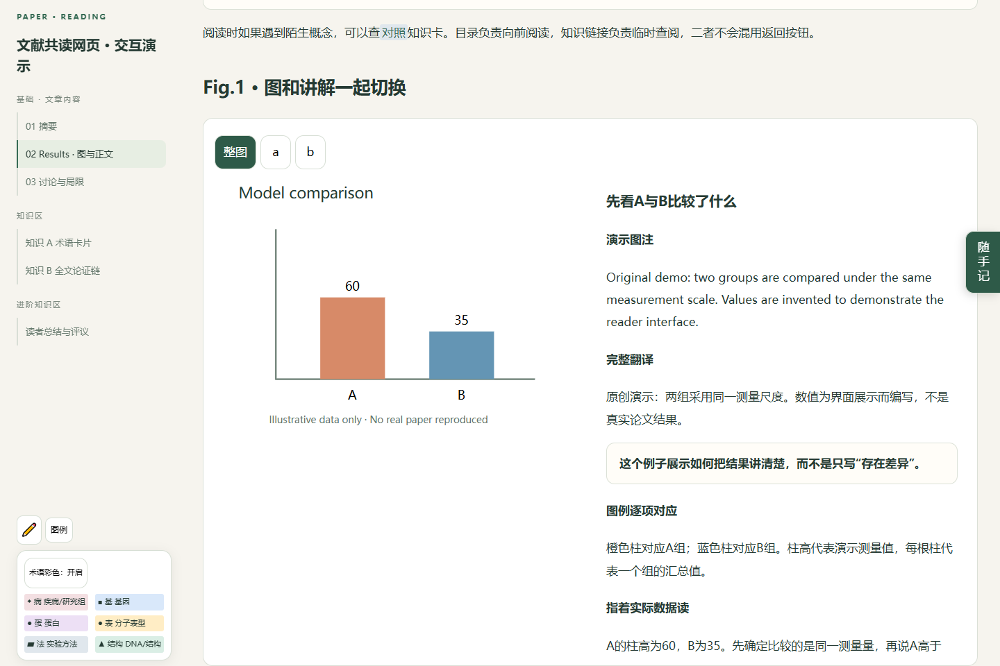

<div align="center">

**简体中文 · [English](README.en.md)**


### 把读懂的内容留下，下次不用从头问起

解释留在论文旁，问题和笔记随着阅读积累。

[](https://github.com/BerryIcey/paper-to-html/releases/latest)
[](https://github.com/BerryIcey/paper-to-html/actions/workflows/validate.yml)
[](LICENSE)

**[在线阅读真实案例](https://berryicey.github.io/paper-to-html/) · [下载最新版](https://github.com/BerryIcey/paper-to-html/releases/latest/download/paper-to-html-v2.4.zip) · [查看技能](https://github.com/BerryIcey/paper-to-html/blob/main/skills/paper-to-html-v2.4/SKILL.md) · [更新说明](docs/latest-changes.md) · [快速开始](#三步开始) · [反馈问题](https://github.com/BerryIcey/paper-to-html/issues)**

</div>

**供 Codex 使用的中文论文共读 Skill 与阅读组件。仅在 Codex 测试，其他 Agent 尚未测试。** 把连续原文、完整翻译、读图解释、知识卡和论证链放在同一网页，当前重点是生物医学实验论文。制作需要能读取 PDF 的助手；生成的静态阅读页可离线打开，项目笔记需要本地服务。

## 今天问明白，下一次也找得到

读论文时，和 AI 来回聊了很多轮，当时似乎懂了。隔一段时间再看，却忘了那段推理：要么在很长的对话里翻找，要么把同一个问题重新问一遍。

**paper-to-html 想省下的，就是这部分重复。** 先把论文整理成带原文、翻译、图解和知识卡的网页；读到不懂的地方，就在对应内容旁留下随手记。下一轮让助手处理疑问，按需补充网页讲解并保留处理回复，逐渐积累属于自己的问题、理解与阅读笔记。



**再次打开时，不只重看论文，也能回看“当时卡在哪里、后来怎样理解”。** 不用每次都从空白对话重新开始。随手记需通过本地服务保存，下一轮由助手处理；网页不会即时自动回答或自行更新。

## 先看阅读体验



*实际界面截图，内容为原创模拟文字和图表；不是真实论文成果，也不是 v2.4 全部能力的验收样例。*[下载演示 HTML](https://raw.githubusercontent.com/BerryIcey/paper-to-html/main/demo/paper-reading.html) 后保存，用浏览器打开。也可以直接[在线阅读真实论文案例](https://berryicey.github.io/paper-to-html/)；上图仍是原创模拟界面的截图。

## 直接打开一篇做好的论文

**[在线阅读 Mulet-Lazaro 2024 共读网页 →](https://berryicey.github.io/paper-to-html/)**

直接复用已有中文成品，保留原文、翻译、读图解释、47 张知识卡和论证链，不另外制作一份简化宣传页。它不是 v2.4 从零生成的性能基准。原论文采用 CC BY 4.0，[署名和改编说明](THIRD_PARTY_NOTICES.md)已附上；不公开私人笔记队列与附件。访客可读图查卡、标黄并保留当前浏览器草稿，静态站不能将笔记提交到作者项目。

一次 **v2.4 从零制作的实测记录**（2026-10-29，eCHROMA 论文）：使用 **gpt-6.1-sol / low**，制作耗时约 **19 分 29 秒**，累计 **5,858,896 tokens**，其中 **5,668,096 为缓存输入**、**144,845 为非缓存输入**、**45,955 为输出**。这是单次制作日志统计，包含多轮重复上下文；不是每篇论文的固定消耗、API 账单或当前公开案例的成本。[完整记录与统计口径](docs/usage-observation.md)。

## 三步开始

### 1 · 安装推荐版

下载 [paper-to-html-v2.4.zip](https://github.com/BerryIcey/paper-to-html/releases/latest/download/paper-to-html-v2.4.zip)，解压后将其中完整的 `paper-to-html-v2.4` 文件夹放进当前设备的 Codex Skill 目录，通常是 `~/.codex/skills/`。已有旧安装时先在技能目录外备份。新开聊天确认技能可用。

下载包版本是 **v2.4**，技能调用名称是 **`$paper-to-html-v2.4`**。GitHub 更新不会自动更新电脑上的安装。

### 2 · 提供论文并调用

```text
$paper-to-html-v2.4
把这篇论文做成中文共读网页。
完整翻译核心正文，按论证需要决定详讲、简讲和跨图比较。
重要概念独立讲清，梳理全文论证，保留原图及来源。
```

提供有权使用的 PDF。默认包含核心正文、全部主图、必要知识卡与文末评议；若方法、算法或证明构成论文主贡献，也属于核心；复现级方法细节、附图详解和复习内容可按需追加。缺少补充资料时，助手应说明实际覆盖范围。

### 3 · 阅读并留下问题

静态 HTML 可离线切图、放大、查卡和标记。要保存随手记，请打开该论文的本地阅读服务；问题保存到项目，供下一轮助手处理，**不会即时调用 GPT**。正文与笔记、浏览器草稿与项目文件是不同的保存内容。

<details>
<summary>只想体验组件？启动演示服务</summary>

不需要模型或 OpenAI API 密钥。需要 Python：

```sh
git clone https://github.com/BerryIcey/paper-to-html.git
cd paper-to-html
python skills/paper-to-html-v2.4/assets/reader-components/reading_server.py --root demo --port 18765
```

在同一台设备打开 `http://127.0.0.1:18765/paper-reading.html`。这只是临时演示服务；正式项目需要配置独立后台运行方式。

</details>

## 三个核心阅读体验

| 想读懂什么 | 带读方式 |
|---|---|
| 图中的证据 | 实验目的 → 比较对象 → 图中元素 → 实际观察 → 判断 |
| 陌生概念 | 自足知识卡、本文用途、查阅与返回 |
| 全文逻辑 | 研究问题 → 证据缺口 → 下一步，保留并行与否定结果 |

<details>
<summary>展开详细讲解与功能示意图</summary>


下面使用统一比例的功能示意图，突出阅读过程与操作重点；并非实际界面截图，模拟数据不代表真实论文的研究结论。

### 01 · 逐图带你读：从“看见图”到“读出证据”

每张主图有原始查阅入口，按论证需要详讲、简讲或合讲。切换面板时，原图和文字一起切换；放大原图可以检查标签和细节。

讲解从当前研究问题开始：**为什么做这一步，比较谁和谁，数据怎样变成图里的一个点、格或柱？** 接着逐项解释本图的坐标、颜色、符号和单位，再指着可定位的实际结果，从观察走到判断。最后说明它回答了什么、哪些问题仍没有解决。

因此读者得到的不是一句“结果显著”，而是一条能复述的理解过程。图注、译文、简短结论和详细解释分别保留；图解不能只复述图注，也不能用通用提醒代替实际读图。


### 02 · 术语知识卡：补足理解，不打断阅读

默认读者具备相关专业本科基础；超出这一基础且影响理解的概念，才需要补充解释与查阅入口。术语从当前文章发现，数据库帮助核对名称、定义与来源。

遇到影响理解的陌生概念，可以从正文、译文或图注中的术语链接打开知识卡。卡片需要讲清 **它是什么、怎样工作或关系如何成立、本文为什么使用它，以及哪些判断容易混淆**，而不只是展开一个缩写。

术语从当前论文发现和判断，不以已有词表是否命中为前提。同名不同义按语境区分；相关概念之间先交代关系，避免突然跳到另一个名词。卡片按需展开，查完可以回到原来的小图和文字滚动位置。


### 03 · 全文论证链：看懂每一步为什么需要

单张图能看懂，还需要知道它在全文中做什么。论证链按研究问题连接证据：**已经知道什么 → 还缺什么 → 为什么选这个方法 → 结果如何改变判断**。流程图帮助定位，详细解释补足每条连接的理由。

它不是把图标题排成目录，也不是把术语用箭头串起来。并行证据、没有支持预期的结果、补充验证和尚未解决的分支都应保留；研究顺序不能直接写成事件发生顺序或因果关系。


[下载演示 HTML](https://raw.githubusercontent.com/BerryIcey/paper-to-html/main/demo/paper-reading.html)，保存后用浏览器打开。GitHub 的 HTML 文件页只显示源码。这个项目是供 Codex 使用的 **Skill 与网页阅读组件**，生成解释需要核对当前论文来源。

</details>

## 当前版本

**v2.4 经过 Darwin Skill 辅助优化；未新增功能，未进行额外人工优化。** 仅调整四项验收、整体走读、修复重测流程，包含独立评审和用户人工确认；不据此宣称全文准确性或理解效果提高。

[v2.4 更新说明](docs/latest-changes.md) · [历史版本与下载](docs/versions.md) · [安装与常见问题](docs/getting-started.md)。优化前 v2.3 和更早版本保留；本次首页整理不改变 v2.4 下载包。

## 使用前需要知道

- **制作环境：** 支持 Skill 的助手和 PDF 读取能力；组件与服务使用 Python 标准库，PDF 裁图需要 PyMuPDF，脚本语法检查使用 Node.js；可选浏览器回归需要 Playwright 和已安装浏览器。
- **引用显示：** 原文、译文、图注与讲解去除纯文献引用编号和角标；保留图号、单位、公式/化学上标等科学内容，来源留在台账和原论文。
- **核对范围：** 翻译、图例、数值与推理需要逐项核对。测试通过不证明解释全部正确，也不证明所有领域都已验证。Agent 仅测试 Codex，其他 Agent 尚未测试。
- **保存边界：** 正文可离线阅读；项目笔记依赖本地服务。目前没有断线自动补存、跨设备同步或即时问答。
- **设备访问：** `127.0.0.1` 只供本机使用。手机能读离线文件，不代表能连接电脑的本地地址提交笔记。
- **后台与历史：** 正式项目可保留 0/1/2 个历史备份，最新版另计；Windows 后台方案与其他系统不同，重启存活需另行验证。

## 附加功能 · 阅读时顺手使用

核心是理解论文。下面的工具帮助查阅、标记和保留问题：

| 工具 | 怎么用 |
|---|---|
| 图例与术语颜色 | 查看网页术语的类别，按需关闭底色；网页配色与原图图例分别解释 |
| 荧光笔 | 主动开启后标记文字，支持撤销；个人标黄与术语颜色开关独立 |
| 随手记 | 在侧边记录文字或截图，保存到本地项目，留给下一轮助手处理 |


随手记需要本地阅读服务，静态文件中的草稿不等于已写入项目；保存问题不会即时触发 GPT。图像放大、面板切换和临时查阅返回也可辅助阅读。

## 反馈与参与改进

[提交问题](https://github.com/BerryIcey/paper-to-html/issues)时请写明版本、浏览器、期望行为与实际情况。解释不清楚时，指出卡在哪个对象、比较或推理步骤，比只说“太简略”更有帮助。

当前关注：专门术语漏选与基础知识过选、长论文后半部分讲解质量、触控操作，以及不同论证方式的迁移。请勿上传私人笔记、凭据或未经许可的论文全文。

代码与通用说明使用 [MIT 许可](LICENSE)。论文及第三方图片沿用原有权利条件，公开案例按其独立许可分享，详见[第三方署名](THIRD_PARTY_NOTICES.md)；不公开私人笔记。

有帮助的话，欢迎 **Star** 收藏，方便回来找版本。更有价值的反馈是：哪一段、哪张图、哪个推理还讲不清楚。

[贡献指南](CONTRIBUTING.md) · [提出建议](https://github.com/BerryIcey/paper-to-html/issues/new?template=feature_request.md)
